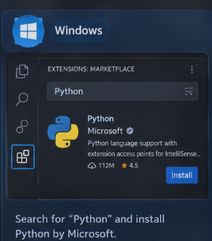
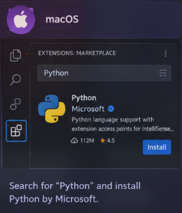
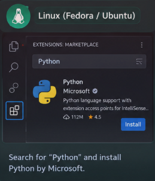

#                                                                                             Setup & Introduction
---

## What is **python**?

**Python** is an interpreted programming language which converts code into machine language line by line. 

---
## Why **python** is used?

**Python** is used to build software's, automate repetitive work, analyse data and work with AI without dealing with as much language complexity as C, C++, Rust, Java etc.

---
## Python Pro's and Con's.

| Pro's                              | Con's                                                                       |
| ---------------------------------- | --------------------------------------------------------------------------- |
| Easy to learn and read             | Slower execution than compiler based languages for many GPU intensive tasks |
| Extensive Libraries and frame work | High chances of runtime error's due to dynamic typing                       |
| Great for High level task's        | Less suitable for low language tasks                                        |
| Great for AI and machine learning  | Higher memory consumption then compiler based languages.                    |

---

## Installing Python:-  (VS Code)

### Windows:- 

1. Install Python from [Official Python Website](https://www.python.org/downloads/?utm_source=chatgpt.com)

2. Install VS Code from [VS Code official website](https://code.visualstudio.com)

3. Install the Python extension: Search for Python by Microsoft in VS Code's Extensions panel.

#### MacOS:-

1. Install Python: Download Python from the [official Python website](https://www.python.org/downloads/?utm_source=chatgpt.com).

2. Install VS Code: Download it from the [official VS Code website](https://code.visualstudio.com/?utm_source=chatgpt.com).

3. Install the Python extension: Search for Python by Microsoft in VS Code's Extensions panel. 

### Linux(Fedora/Ubuntu):- 

1. Install Python: Open your terminal and run `sudo dnf install python3` (Fedora) or `sudo apt install python3 python3-pip` (Ubuntu).

2. Install VS Code: Download it from the [official VS Code website](https://code.visualstudio.com/?utm_source=chatgpt.com).

3. Install the Python extension: Open VS Code, go to Extensions (`Ctrl + Shift + X`), and install Python by Microsoft. 

---

### Create your first program:-

- To create a python program you have to use the `.py`  extension at the end of your file name. 

- Run Python: Create `main.py`. 

